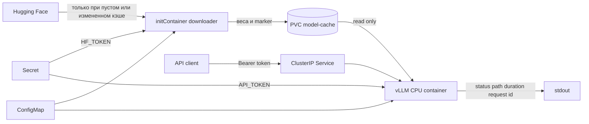

# CPU инференс LLM с vLLM в Kubernetes

Репозиторий разворачивает OpenAI-совместимый API для `Qwen/Qwen2.5-0.5B-Instruct` на CPU. Модель один раз скачивается отдельным `initContainer` в `PersistentVolumeClaim`, после чего vLLM загружает ее локально. Оба образа и оба контейнера работают без root. Тела запросов и ответы не попадают в логи.

Решение покрывает основные требования и два архитектурных бонуса: Kustomize и отдельный rootless-образ загрузчика. Для исследовательского бонуса добавлен воспроизводимый нагрузочный тест; численные результаты нужно получить на той машине, характеристики которой будут указаны вместе с таблицей.

## Архитектура



Жизненный цикл пода:

1. Kubernetes подключает PVC к `initContainer`.
2. `download_model.py` сравнивает `MODEL_ID` и `MODEL_REVISION` с атомарным marker-файлом.
3. При cache miss Hugging Face Hub докачивает snapshot в `/models/model`; marker создается только после успешной загрузки и проверки `config.json`.
4. После завершения `initContainer` запускается основной контейнер. Он получает тот же PVC только для чтения и включает offline-режим Hugging Face.
5. `PrivacyAndAuthMiddleware` проверяет Bearer token на всех непубличных маршрутах и пишет только метод, путь, статус, request id и длительность. Тело запроса и тело ответа middleware принципиально не читает.

## Состав репозитория

```text
.
├── Dockerfile                         rootless-образ vLLM 0.27.0 CPU
├── Dockerfile.downloader              rootless-образ загрузчика модели
├── requirements.txt                   pin основной поставки vLLM
├── requirements-downloader.txt        полный pin графа загрузчика
├── app/
│   ├── entrypoint.sh                  безопасная сборка аргументов vLLM
│   └── privacy_middleware.py           аутентификация и metadata-only logging
├── scripts/
│   ├── download_model.py              идемпотентное заполнение PVC
│   ├── load_test.py                   TTFT, latency и throughput
│   └── validate_project.py            офлайн-проверки репозитория
├── tests/test_privacy_middleware.py   тесты приватности и авторизации
└── k8s/
    ├── base/                           Deployment, PVC, Service, ConfigMap, policy
    └── overlays/minikube/              Secret generator для локального запуска
```

## Предварительные требования

- Linux x86-64 с AVX2; AVX-512 предпочтителен.
- Docker или встроенная сборка образов Minikube.
- Minikube и `kubectl`.
- Рекомендуется не менее 6 CPU, 10 ГиБ RAM и 30 ГиБ диска для Minikube.
- Первый запуск требует доступ к `huggingface.co` по HTTPS. Дальнейшие рестарты используют PVC.

vLLM 0.27.0 поддерживает CPU, а официальный CPU-образ имеет тег `v0.27.0-x86_64`. Для CPU явно выбран `bfloat16`: поддержка `float16` на CPU менее стабильна. Выбранная instruct-модель небольшая, публичная и подходит для локальной машины; пустой `HF_TOKEN` для нее допустим.

## Быстрый запуск в Minikube

Все команды выполняются из корня репозитория.

```bash
minikube start --cpus=6 --memory=10240mb --disk-size=30g

minikube image build -t local/model-downloader:0.1.0 -f Dockerfile.downloader .
minikube image build -t local/vllm-cpu:0.27.0 -f Dockerfile .

cp k8s/overlays/minikube/secret.env.example k8s/overlays/minikube/secret.env
```

Замените `API_TOKEN` в `secret.env` случайной строкой длиной не менее 32 символов. Для публичной модели `HF_TOKEN` можно оставить пустым. Сам `secret.env` исключен из Git.

```bash
kubectl apply -k k8s/overlays/minikube
kubectl -n llm-inference rollout status deployment/vllm-cpu --timeout=20m
kubectl -n llm-inference get pods,pvc,service
```

На первом запуске ожидание включает скачивание модели и инициализацию CPU backend. Текущий прогресс:

```bash
kubectl -n llm-inference logs deployment/vllm-cpu -c model-downloader -f
kubectl -n llm-inference logs deployment/vllm-cpu -c vllm -f
```

## Проверка API

В одном терминале:

```bash
kubectl -n llm-inference port-forward service/vllm-cpu 8000:8000
```

В другом терминале:

```bash
export API_TOKEN='значение-из-secret.env'
curl -sS http://127.0.0.1:8000/v1/chat/completions \
  -H "Authorization: Bearer ${API_TOKEN}" \
  -H 'Content-Type: application/json' \
  -d '{
    "model": "qwen2.5-0.5b-instruct",
    "messages": [{"role": "user", "content": "Что такое PagedAttention?"}],
    "temperature": 0,
    "max_tokens": 64
  }'
```

Без заголовка `Authorization` запрос должен вернуть `401`. `/health`, `/metrics` и `/version` оставлены публичными внутри ClusterIP для probes и мониторинга; `NetworkPolicy` ограничивает входящий трафик namespace-ом `llm-inference`.

## Проверка кэша PVC

После успешного первого запуска удалите под:

```bash
kubectl -n llm-inference delete pod -l app.kubernetes.io/name=vllm-cpu
kubectl -n llm-inference rollout status deployment/vllm-cpu --timeout=10m
kubectl -n llm-inference logs deployment/vllm-cpu -c model-downloader
```

В логах initContainer появится `model cache hit`; повторного скачивания весов не будет. При изменении `MODEL_ID` или `MODEL_REVISION` загрузчик обновит snapshot и marker.

## Приватность логирования

Используются три независимых меры:

- vLLM запущен с `--no-enable-log-requests` и `--no-enable-log-outputs`;
- уровень логирования `INFO`, а `VLLM_REQUEST_BODY_LOG_LEVEL=CRITICAL` не дает случайно включить вывод тела на обычном debug-уровне;
- собственный middleware не вызывает `receive`, то есть физически не читает prompt, и не сохраняет response chunks.

Проверка canary-строкой:

```bash
curl -sS http://127.0.0.1:8000/v1/chat/completions \
  -H "Authorization: Bearer ${API_TOKEN}" \
  -H 'Content-Type: application/json' \
  -d '{"model":"qwen2.5-0.5b-instruct","messages":[{"role":"user","content":"PRIVATE_CANARY_7d091f"}],"max_tokens":8}'

kubectl -n llm-inference logs deployment/vllm-cpu -c vllm | grep PRIVATE_CANARY_7d091f
```

Последняя команда не должна вывести ни одной строки. При этом в логах будет JSON-событие `inference_http_request` с фактом обращения, кодом ответа и длительностью.

## Нагрузочное тестирование

Скрипт использует streaming API. TTFT измеряется от отправки HTTP-запроса до первого непустого content delta, latency — до завершения stream, throughput — как число сгенерированных токенов за общее wall-clock время теста. Скрипт не сохраняет тексты ответов.

```bash
python scripts/load_test.py \
  --api-key "$API_TOKEN" \
  --requests 12 \
  --concurrency 4 \
  --max-tokens 64
```

Будут проверены короткий и длинный prompts. Результаты сохраняются в JSON и Markdown внутри `benchmark-results/`; Markdown-таблицу следует вставить сюда перед отправкой решения вместе с CPU, RAM, ОС и параметрами Minikube. Не следует публиковать выдуманные показатели: они зависят от процессора, доступной памяти, фоновой нагрузки и прогрева.

| Prompt | Success | TTFT p50, s | TTFT p95, s | Latency mean, s | Latency p95, s | Tokens/s | Requests/s |
|---|---:|---:|---:|---:|---:|---:|---:|
| short | запуск обязателен | - | - | - | - | - | - |
| long | запуск обязателен | - | - | - | - | - | - |

### Какие параметры повышают throughput

**Много коротких запросов.** Главный выигрыш дает увеличение `MAX_NUM_SEQS`: scheduler получает больше одновременно активных последовательностей и лучше использует continuous batching. `MAX_NUM_BATCHED_TOKENS` должен быть достаточно большим, чтобы короткие prefills и decode-токены помещались в общий шаг. Если у запросов общий системный prompt, полезен prefix caching. Значение нужно повышать до насыщения физических CPU-ядер и пропускной способности памяти; слишком высокая конкуррентность ухудшит latency из-за очереди и переключений.

**Меньше запросов с огромным контекстом.** Нужны достаточные `MAX_MODEL_LEN`, `MAX_NUM_BATCHED_TOKENS` и объем `VLLM_CPU_KVCACHE_SPACE`. Chunked prefill не дает одному длинному prompt монополизировать scheduler и снижает риск пиков памяти. Prefix caching особенно полезен для повторяющейся длинной части контекста. Цена увеличения контекста — больше KV cache и более долгий prefill, поэтому эти параметры нельзя увеличивать без измерений.

На CPU инференс часто ограничен пропускной способностью памяти. Квантизация может уменьшить размер весов и трафик памяти, но конкретный формат нужно выбирать после проверки поддержки моделью и CPU backend; в базовом варианте оставлен более переносимый BF16.

## Конфигурация без пересборки

Параметры модели и scheduler находятся в `k8s/base/configmap.yaml`. После изменения:

```bash
kubectl apply -k k8s/overlays/minikube
kubectl -n llm-inference rollout restart deployment/vllm-cpu
```

Важно: изменение ConfigMap, переданной как environment variables, само по себе не перезапускает существующий pod. Для автоматического rollout в production обычно применяют checksum-аннотацию через Helm/оператор или GitOps-контроллер.

## Безопасность и воспроизводимость

- UID/GID `10001`, `runAsNonRoot`, `allowPrivilegeEscalation: false`, `readOnlyRootFilesystem: true`, `seccompProfile: RuntimeDefault`, все Linux capabilities удалены.
- Service имеет тип `ClusterIP`; наружу API по умолчанию не публикуется.
- ServiceAccount token не монтируется.
- Основной контейнер читает PVC только read-only и работает с `HF_HUB_OFFLINE=1`.
- API token сравнивается через `hmac.compare_digest`.
- `Secret` не хранится в репозитории. Kubernetes Secret — не шифрование само по себе; для production нужны encryption at rest и External Secrets/Vault.
- `.gitattributes` сохраняет LF в shell-скриптах даже при работе с Git на Windows, поэтому shebang корректно запускается внутри Linux-контейнера.
- Версия vLLM зафиксирована как `0.27.0`. Основной образ не устанавливает дополнительных Python-пакетов: полный транзитивный runtime приходит из versioned official CPU image. Загрузчик имеет отдельный полностью pinned граф в `requirements-downloader.txt`.
- Для строгой supply-chain фиксации в production после проверки образов следует заменить Docker tags на digest (`image@sha256:...`) и добавить hash-ы wheels. В тестовом проекте оставлены читаемые version tags, чтобы сборка работала на разных Minikube-инсталляциях.

## Локальные проверки

Без Docker и Kubernetes доступны синтаксические и security-invariant проверки:

```bash
python scripts/validate_project.py
python -m unittest discover -s tests -v
```

Если установлены инструменты инфраструктуры, добавьте:

```bash
kubectl kustomize k8s/overlays/minikube >/dev/null
docker build -t local/model-downloader:0.1.0 -f Dockerfile.downloader .
docker build -t local/vllm-cpu:0.27.0 -f Dockerfile .
```


## Источники

- [vLLM CPU installation](https://docs.vllm.ai/en/v0.27.0/getting_started/installation/cpu/)
- [vLLM serve arguments 0.27.0](https://docs.vllm.ai/en/v0.27.0/cli/serve/)
- [Kubernetes Init Containers](https://kubernetes.io/docs/concepts/workloads/pods/init-containers/)
- [Kubernetes Persistent Volumes](https://kubernetes.io/docs/concepts/storage/persistent-volumes/)
- [Kustomize](https://kubernetes.io/docs/tasks/manage-kubernetes-objects/kustomization/)

