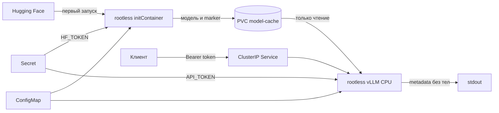

# vLLM CPU в Kubernetes

Тестовое задание: развернуть на CPU OpenAI-совместимый API vLLM 0.27.0 в
Kubernetes, безопасно скачать и кэшировать модель, не записывать prompts и ответы
в логи и измерить производительность.

Проверенный результат: `Qwen/Qwen2.5-0.5B-Instruct` отвечает через endpoint
`/v1/chat/completions`; запросы без Bearer token получают `401`; после первого
запуска модель остается в PVC и не скачивается повторно; в логах есть факт и
длительность запроса, но нет его текста и ответа.

## Что здесь происходит



1. `initContainer` запускается раньше vLLM и скачивает snapshot модели в PVC.
2. Marker-файл делает загрузку идемпотентной: при совпадении модели и revision
   повторный запуск сообщает `model cache hit`.
3. Основной контейнер монтирует тот же PVC только для чтения и работает offline.
4. vLLM предоставляет API, совместимый с OpenAI.
5. Middleware проверяет токен и пишет только method, path, status, request id и
   duration. Он принципиально не читает request/response bodies.

## Соответствие заданию

| Требование | Реализация |
|---|---|
| vLLM не ниже 0.27.0, CPU-only | digest-pinned CPU base image vLLM `0.27.0+cpu` |
| Собственный Dockerfile, запуск не от root | UID/GID 10001 в обоих образах; `runAsNonRoot` в Pod |
| Все Python-зависимости закреплены | полный runtime lock в `requirements.txt`; сверяется при сборке |
| Не логировать prompts и ответы | флаги vLLM, ASGI middleware без чтения body, unit-тесты |
| Логировать факт запроса | JSON-событие `inference_http_request` с безопасными полями |
| Модель хранится в PVC | `model-cache`; основной контейнер монтирует его read-only |
| Токены в Secret | `HF_TOKEN` и `API_TOKEN` создаются из локального `secret.env` |
| Конфигурация в ConfigMap | модель, scheduler, порт, dtype и CPU-параметры |
| Kustomize | `k8s/base` и `k8s/overlays/minikube` |
| Отдельный initContainer | отдельный rootless-образ `model-downloader` |
| Нагрузочный тест | streaming TTFT, latency, tokens/s и requests/s |

Дополнительно настроены startup/readiness/liveness probes, resource requests и
limits, `ClusterIP`, NetworkPolicy, `RuntimeDefault` seccomp, read-only root FS,
удаление capabilities и отключение service-account token.

## Структура

```text
.
├── Dockerfile                         образ vLLM CPU
├── Dockerfile.downloader              образ initContainer
├── requirements.txt                   полный lock runtime vLLM
├── requirements-downloader.txt        полный lock загрузчика
├── app/
│   ├── entrypoint.sh                  безопасные параметры vLLM
│   └── privacy_middleware.py           auth и metadata-only logging
├── scripts/
│   ├── download_model.py              заполнение и проверка PVC
│   ├── load_test.py                   нагрузочный тест
│   ├── verify_runtime_lock.py          сверка lock с образом
│   └── validate_project.py            быстрый аудит репозитория
├── tests/test_privacy_middleware.py
├── benchmark-results/README.md         проверенные измерения
└── k8s/
    ├── base/                           Kubernetes-ресурсы
    └── overlays/minikube/              локальный overlay и Secret generator
```

## Требования к машине

- x86-64 CPU с AVX2;
- Docker Desktop, Minikube и `kubectl`;
- рекомендуется выделить Minikube 6 CPU, 10 ГиБ RAM и 30 ГиБ диска;
- HTTPS-доступ к Hugging Face при первой загрузке модели.

Проверенное окружение: Windows 11/WSL2, Intel Core 5 210H (8 ядер, 12
логических процессоров), 31.6 ГиБ RAM. Первый cold start занял около 16 минут,
включая загрузку и инициализацию; перезапуск с моделью в PVC — около 3 минут.

## Запуск в Windows PowerShell

Все команды выполняются из корня репозитория.

```powershell
minikube start --cpus=6 --memory=10240mb --disk-size=30g

minikube image build -t local/model-downloader:0.1.0 -f Dockerfile.downloader .
minikube image build -t local/vllm-cpu:0.27.0 -f Dockerfile .

Copy-Item k8s\overlays\minikube\secret.env.example `
    k8s\overlays\minikube\secret.env
```

В `secret.env` замените `API_TOKEN` случайной строкой не короче 32 символов.
Публичная модель работает с пустым `HF_TOKEN`. Файл уже исключен из Git.

```powershell
kubectl apply -k k8s/overlays/minikube
kubectl -n llm-inference rollout status deployment/vllm-cpu --timeout=20m
kubectl -n llm-inference get pods,pvc,service
```

Ожидаемый финальный статус Pod: `1/1 Running`. Прогресс можно смотреть так:

```powershell
kubectl -n llm-inference logs deployment/vllm-cpu -c model-downloader -f
kubectl -n llm-inference logs deployment/vllm-cpu -c vllm -f
```

## Проверка API

Оставьте первый терминал открытым:

```powershell
kubectl -n llm-inference port-forward service/vllm-cpu 8000:8000
```

Во втором терминале загрузите токен и отправьте UTF-8 JSON:

```powershell
$env:API_TOKEN = ((Get-Content k8s\overlays\minikube\secret.env |
    Where-Object { $_ -like "API_TOKEN=*" }) -split "=", 2)[1]

$body = @{
    model = "qwen2.5-0.5b-instruct"
    messages = @(@{ role = "user"; content = "Объясни Kubernetes в двух предложениях" })
    temperature = 0
    max_tokens = 64
} | ConvertTo-Json -Depth 5 -Compress

$response = Invoke-RestMethod `
    -Uri "http://127.0.0.1:8000/v1/chat/completions" `
    -Method Post `
    -Headers @{ Authorization = "Bearer $env:API_TOKEN" } `
    -ContentType "application/json; charset=utf-8" `
    -Body ([Text.Encoding]::UTF8.GetBytes($body))

$response.choices[0].message.content
```

В Windows PowerShell 5.1 отображение русского текста иногда ломается. Это не
ошибка модели; установите перед выводом:

```powershell
[Console]::OutputEncoding = [Text.Encoding]::UTF8
$OutputEncoding = [Text.Encoding]::UTF8
```

## Проверка PVC и приватности

Удаление Pod не удаляет PVC:

```powershell
kubectl -n llm-inference delete pod -l app.kubernetes.io/name=vllm-cpu
kubectl -n llm-inference rollout status deployment/vllm-cpu --timeout=10m
kubectl -n llm-inference logs deployment/vllm-cpu -c model-downloader
```

Ожидается строка `model cache hit` без повторного скачивания весов.

Для проверки логов отправьте prompt с уникальной canary-строкой, затем:

```powershell
kubectl -n llm-inference logs deployment/vllm-cpu -c vllm |
    Select-String "PRIVATE_CANARY_7d091f"

kubectl -n llm-inference logs deployment/vllm-cpu -c vllm |
    Select-String "inference_http_request" |
    Select-Object -Last 3
```

Первая команда не должна вернуть ничего. Вторая должна показать JSON с фактом
HTTP-запроса. В проверенном запуске canary отсутствовала, а событие со статусом
`200` и duration присутствовало.

## Нагрузочное тестирование

Скрипт использует streaming API: TTFT — время до первого content delta, latency —
время до конца stream. Тексты ответов не сохраняются.

```powershell
python scripts\load_test.py `
    --api-key $env:API_TOKEN `
    --requests 4 `
    --concurrency 2 `
    --max-tokens 16 `
    --timeout 600
```

Проверенный прогретый запуск:

| Prompt | Success | TTFT p50, s | TTFT p95, s | Latency mean, s | Latency p95, s | Tokens/s | Requests/s |
|---|---:|---:|---:|---:|---:|---:|---:|
| short | 4/4 | 1.915 | 2.535 | 4.202 | 4.280 | 7.58 | 0.47 |
| long | 4/4 | 4.031 | 5.376 | 7.332 | 7.542 | 4.35 | 0.27 |

Полная методика и последовательный контрольный запуск находятся в
[`benchmark-results/README.md`](benchmark-results/README.md). В этом workload
повторялись одинаковые prompts, поэтому prefix cache достиг 69.4%; это объясняет
ускорение повторного длинного prefill и явно учитывается при интерпретации.

### Что влияет на производительность

- Для множества коротких запросов помогают concurrency, `MAX_NUM_SEQS` и
  continuous batching. Слишком высокие значения создают очередь и портят latency.
- Для длинного контекста важны `MAX_MODEL_LEN`, `MAX_NUM_BATCHED_TOKENS`, объем
  KV cache и chunked prefill. Длинный prefill дороже и требует больше памяти.
- Prefix caching полезен при общем system prompt или повторяющемся префиксе, но
  почти не помогает полностью уникальным запросам.
- CPU-инференс часто ограничен пропускной способностью памяти. Квантизация может
  помочь, но формат нужно отдельно проверять на совместимость с CPU backend.

## Изменение конфигурации

Настройки находятся в `k8s/base/configmap.yaml`. После правки env-конфигурации:

```powershell
kubectl apply -k k8s/overlays/minikube
kubectl -n llm-inference rollout restart deployment/vllm-cpu
```

`MODEL_REVISION=main` удобен для демонстрации. Для неизменяемого production
deployment его следует заменить на полный Hugging Face commit SHA.

## Воспроизводимость и проверки

Основной образ закреплен digest-ом. `requirements.txt` содержит все установленные
Python distribution с точными версиями; `verify_runtime_lock.py` во время
Docker build завершает сборку ошибкой при пропущенном пакете или несовпадении.
Downloader имеет отдельный полный lock-файл.

```powershell
python scripts\validate_project.py
python -m unittest discover -s tests -v
kubectl kustomize k8s/overlays/minikube | Out-Null
```

Kubernetes `Secret` — не шифрование само по себе. В production дополнительно
нужны encryption at rest и внешний secret manager. Теги локальных итоговых
образов читаемы для Minikube; их исходные базовые образы и зависимости закреплены.

## Источники

- [vLLM CPU installation](https://docs.vllm.ai/en/v0.27.0/getting_started/installation/cpu/)
- [vLLM serve arguments 0.27.0](https://docs.vllm.ai/en/v0.27.0/cli/serve/)
- [Kubernetes Init Containers](https://kubernetes.io/docs/concepts/workloads/pods/init-containers/)
- [Kubernetes Persistent Volumes](https://kubernetes.io/docs/concepts/storage/persistent-volumes/)
- [Kustomize](https://kubernetes.io/docs/tasks/manage-kubernetes-objects/kustomization/)
